> **讲座信息**
>
> - **主讲**：顾俊　亚信安全 · 江苏区域技术经理
> - **主办**：南京信息工程大学 网络安全学院 ·「企业家进高校前沿大课堂」
> - **时间**：2026-10-28 下午
> - **材料**：现场录音转写（约覆盖后 3/4，开场部分缺失）+ 现场截图 32 张（对应原 PPT 44 页中的 32 页）
> - **说明**：本文结构与数据以截图里的 PPT 为准；标了「**现场补充**」的是讲师脱稿讲的、PPT 上没有的内容。录音是语音识别稿，产品名和专有名词有若干识别错误，我按上下文校正过；实在无法确认的地方做了模糊处理，没有硬猜。

---

## 一页纸结论

整场讲座的骨架只有三条线，标题页上写得很清楚：**AI 改写攻击 / 保护 AI 自身 / AI 赋能安全**。听起来像三个话题，其实是同一个判断在不同位置上的投影——**AI 把攻防两端的"吞吐量"都抬高了一个量级，而安全工程的重心，从"判断内容对不对"整体搬到了"限制能力有多大"。**

如果只记三句话：

1. **攻击侧**变化的关键不是"攻击者更强"，而是"门槛更低、产能更高"。所以防御指标要从"检出率高不高"改成"单位时间能处置多少"。
2. **智能体安全**的核心不是"模型有多聪明"，而是"它被授予了什么权限"。注入只是扣动扳机，权限才是枪的口径。
3. **AI 安全不是另起炉灶**。ATLAS 里约七成的缓解措施可以直接映射到现有安全控制——它更像是把已有的安全工程能力延伸到一批新资产上。

---

## 0. 全场目录（原 PPT 44 页）

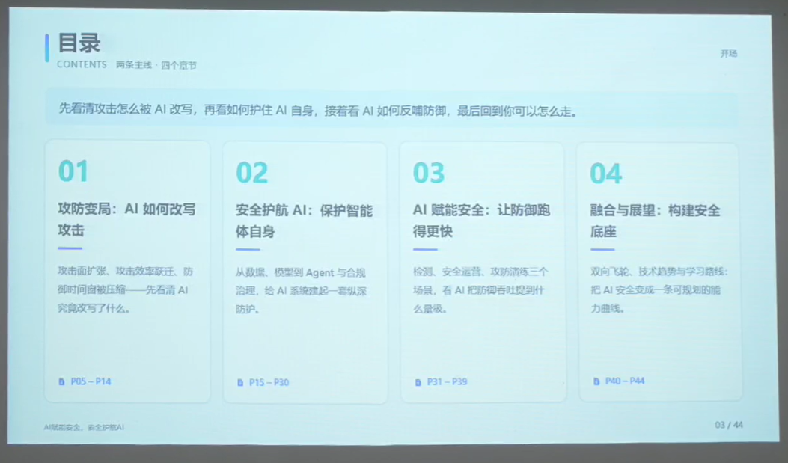
*03 / 44 · 目录：攻防变局 → 安全护航 AI → AI 赋能安全 → 融合与展望*

这个"两条战线"的排布值得留意：第 1、2 章是**安全 for AI**（AI 带来的新风险），第 3 章是 **AI for 安全**（AI 提升防御能力）。讲师反复强调这两者是咬合的——第 4 章用"飞轮"来收尾：AI 让安全做得更好，做安全的过程又反过来保护了 AI。

---

## 一、攻防变局：AI 到底改了哪一环

### 1.1 攻击链没变形，变的是每一环的耗时

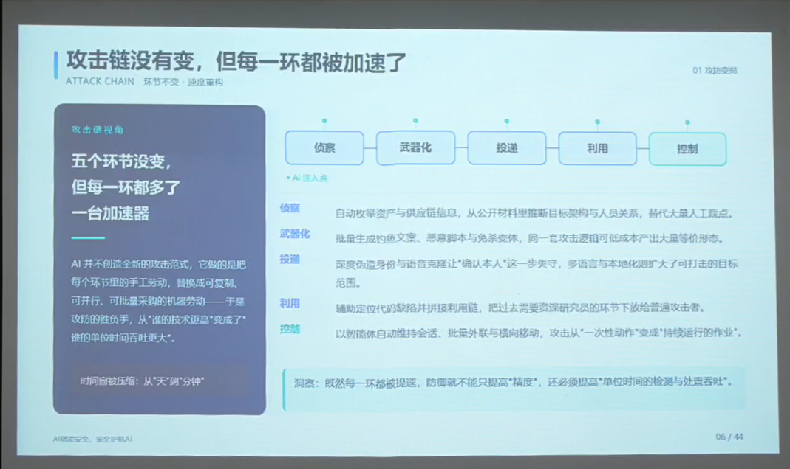
*06 / 44 · 侦察 → 武器化 → 投递 → 利用 → 控制，每一环都被 AI 加速*

PPT 把经典杀伤链拆开逐环比对，这一页是全场的铺垫：

| 环节 | AI 加速了什么 |
| --- | --- |
| 侦察 | 自动枚举资产与供应链信息，从公开材料里推断目标架构与人员关系 |
| 武器化 | 批量生成钓鱼文案、恶意脚本与免杀变体 |
| 投递 | 深度伪造身份与语音克隆，让"确认本人"这一步失守 |
| 利用 | 辅助定位代码缺陷并拼接利用链 |
| 控制 | 以智能体自动维持会话、批量外联与横向移动 |

结论一句话：**既然每一环都被提速，防御就不能只提"精度"，还必须提"单位时间的检测与处置吞吐"。** 这句话在后面第 3 章（降噪、多智能体）和第 4 章（攻防演练"比的是吞吐能力"）反复出现，是整场的暗线。

### 1.2 攻击者的 AI 工具箱：门槛下降，产能上升

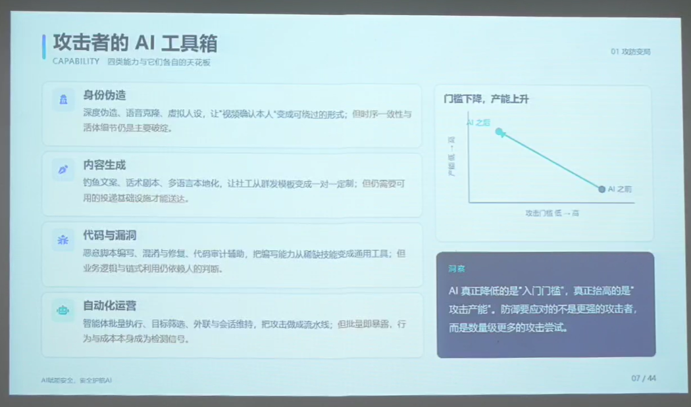
*07 / 44 · 身份伪造 / 内容生成 / 代码与漏洞 / 自动化运营*

最锋利的一句洞察是：**AI 真正降低的是"入门门槛"，真正抬高的是"攻击产能"。** 所以防御要应对的不是"更强的攻击者"，而是"数量级更多的攻击尝试"。

这句话对防御的实际含义是：过去那种"针对高水平对手做深度对抗"的资源分配方式会失效——你可能没有高级对手，但你会被海量的、质量一般的、自动化的攻击淹没。

### 1.3 两个已经跑通的攻击面：深度伪造与 AI 钓鱼

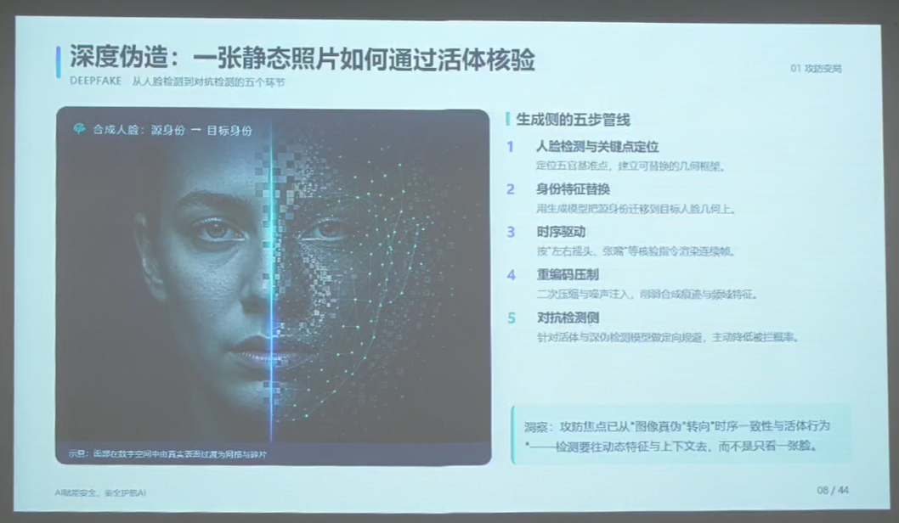
*08 / 44 · 一张静态照片如何变成可通过活体核验的视频*

伪造的管线是：人脸检测与关键点定位 → 身份特征替换 → 时序驱动 → 重编码压缩 → 对抗检测侧。攻防焦点因此从"图像真伪"整体转向**"时序一致性与活体行为"**——静态水印和像素级取证已经不是主战场了。

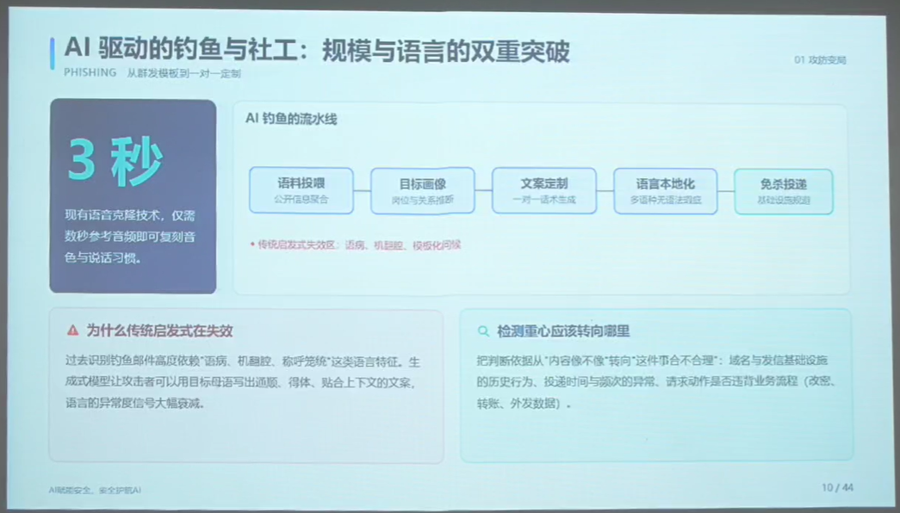
*10 / 44 · 传统检测失效区，与检测重心的转移*

钓鱼这一页的细节挺实用：**3 秒语音样本就足以克隆音色**；流水线是"语料投喂 → 目标画像 → 文案定制 → 语言本地化 → 投递设施规避"。

而我们习惯用的启发式特征——语病、机翻腔、模板化问候——现在全部失效，因为这些恰恰是大模型最擅长抹平的东西。检测重心于是换到三个更"硬"的维度：

- 域名与发信**基础设施的历史行为**（而不是邮件文本）
- 投递**时间与频次**的异常
- 请求的动作**是否违背业务流程**（改密、转账、外发数据）

### 1.4 AI 生成恶意代码：门槛已经不是"会不会写代码"

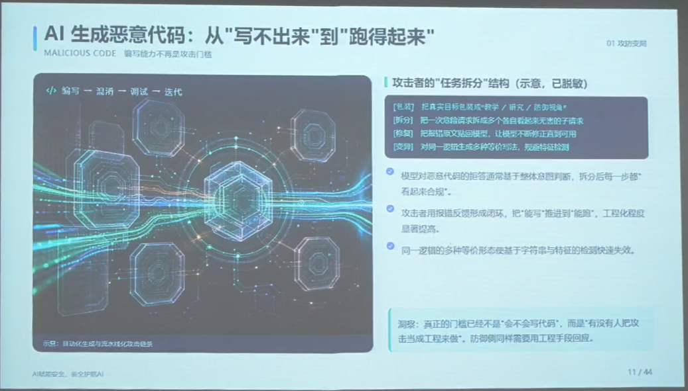
*11 / 44 · 编写 → 混淆 → 调试 → 迭代*

这一页讲的是"任务拆分"结构，也是我认为最值得学的一段攻防细节——**攻击者是怎么把模型的安全对齐绕过去的**：

| 手法 | 做法 |
| --- | --- |
| 包壳 | 把真实目标包装成"教学 / 研究 / 防御视角" |
| 拆分 | 把一次危险请求拆成多个各自看起来无害的子请求 |
| 修理 | 把报错原文贴回模型，让模型不断修正直到可用 |
| 变异 | 对同一逻辑生成多种等价写法，规避特征检测 |

三条机制解释它为什么有效：

- **模型对恶意代码的拒绝通常基于整体意图判断**，拆成每一步之后就"看起来合规"了；
- **攻击者用报错反馈形成闭环**，把"能写"推进到"能跑"，工程化程度显著提高；
- **同一逻辑的多种等价形态，使基于字符串与特征的检测快速失效。**

所以落点很狠：**真正的门槛已经不是"会不会写代码"，而是"有没有人把攻击当成工程来做"。防御侧同样需要用工程手段回应。**

这也解释了第 3 章为什么反复讲"吞吐"——对手在工程化，我们还在靠人盯。

### 1.5 AI 已经能自己找漏洞了

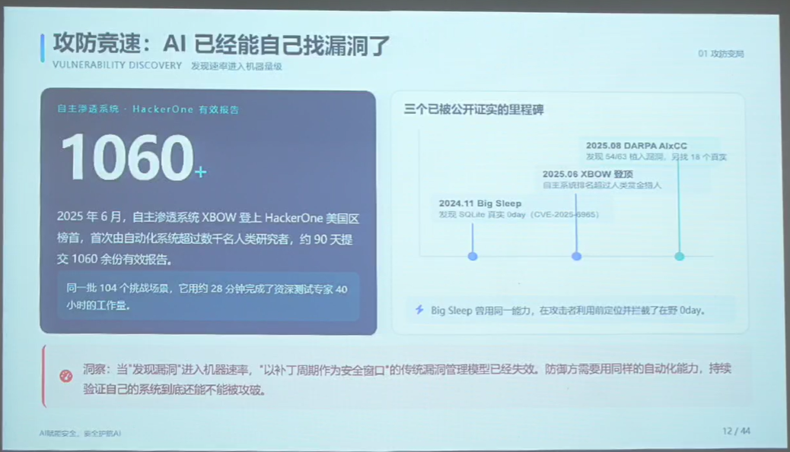
*12 / 44 · 三条时间线，一个拐点*

三件事串起来看才有冲击力：

- **2024.11** Google Big Sleep 发现 SQLite 真实 0day（CVE-2025-6965），在攻击者利用前发现并拦截了在野 0day；
- **2025.06** XBOW 登上 HackerOne 美国区榜首，首次由自动化系统超过数千名人类研究员，约 90 天提交 1060 余份有效报告；
- **2025.08** DARPA AIxCC：发现 54 / 63 个植入漏洞。

还有一组换算很扎心：**同一批 104 个挑战场景，用约 28 分钟完成了资深测试专家 40 小时的工作量。**

这意味着"以补丁周期作为安全窗口"的传统漏洞管理模型已经失效——当发现漏洞进入机器速率，你的暴露窗口不再由厂商的补丁速度决定，而由对手的扫描频率决定。

### 1.6 数据侧：HackerOne 2025 年度报告

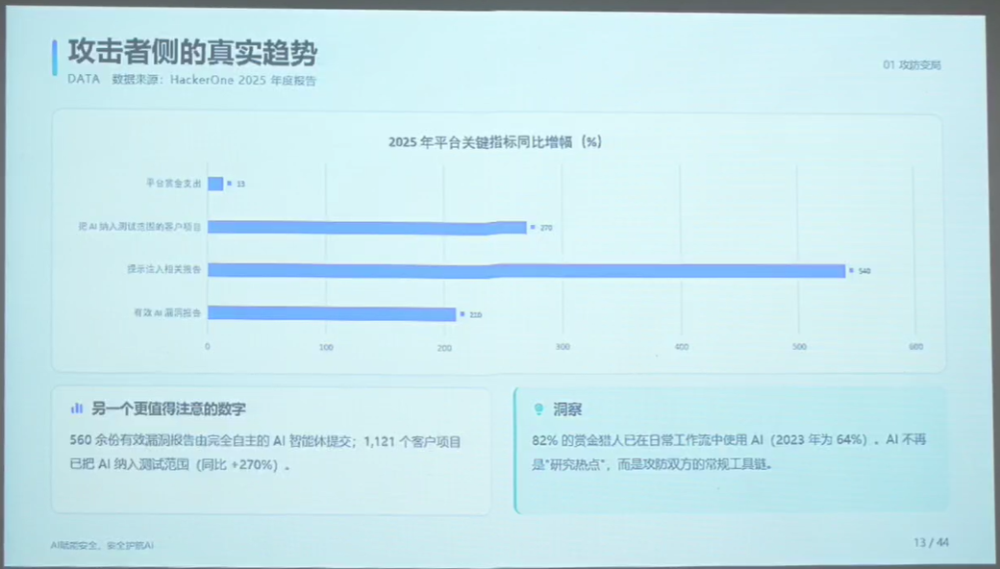
*13 / 44 · 提示注入相关报告同比 +540%*

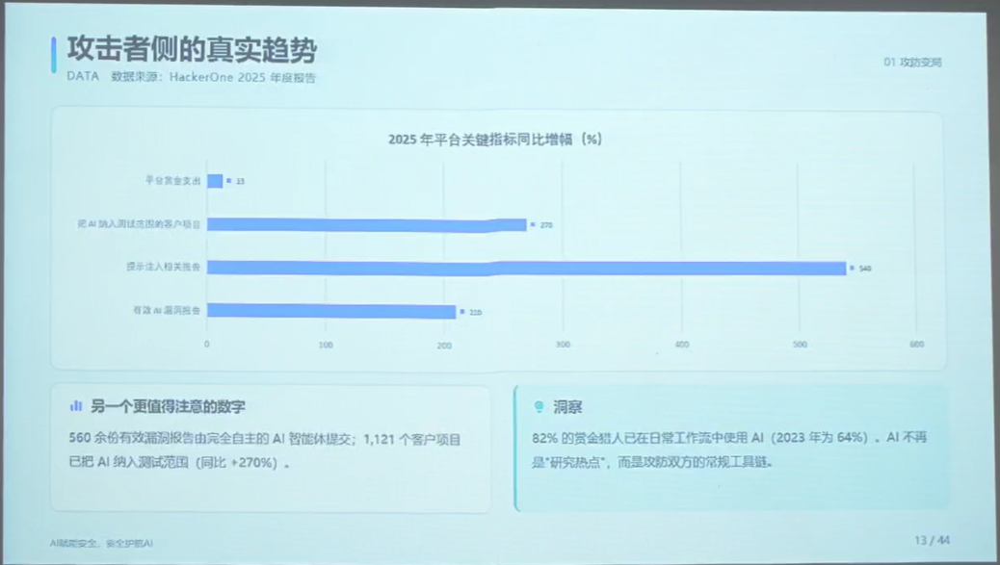
*13 / 44 · 同页（第二个角度，凑齐了横轴刻度）*

| 指标（2025 同比） | 增幅 |
| --- | --- |
| 提示注入相关报告 | **+540%** |
| 有效 AI 漏洞报告 | +210% |
| 把 AI 纳入测试范围的客户项目 | +270% |
| 平台资金支出 | +13% |

另外两个数字：**560 余份有效漏洞报告由完全自主的 AI 智能体提交**；1,121 个客户项目已把 AI 纳入测试范围。而 82% 的赏金猎人已经在日常工作流里使用 AI（2023 年是 64%）。

最后这个 64% → 82% 比前面几个大百分比更能说明问题：**AI 不再是"研究热点"，而是攻防双方的常规工具链。**

### 1.7 小结：三个变化，三条对策

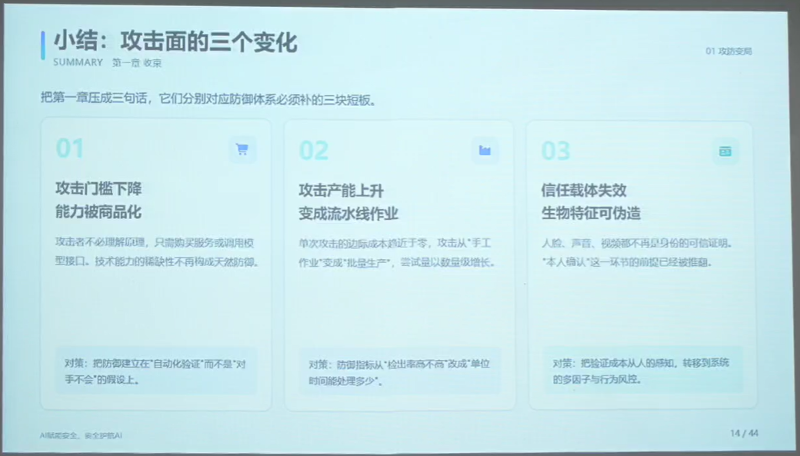
*14 / 44 · 本章小结*

| 变化 | 对策 |
| --- | --- |
| 攻击门槛下降、能力被商品化 | 防御建立在"自动化验证"之上，而不是"对手不会"的假设上 |
| 攻击产能上升、流水线作业 | 防御指标从"检出率高不高"改为"单位时间能处理多少" |
| 信任载体失效、生物特征可伪造 | 把验证成本从"人的感知"转移到系统的多因子与行为风控 |

第三条最值得记：**"本人确认"这一环节的前提已经被推翻了。** 以前我们说"转账前打个电话确认"，现在电话那头的声音也可能是假的。

---

## 二、安全护航 AI：智能体自身怎么被攻破

这一章是全场最厚的一段（PPT 第 15–30 页），也是最值得反复看的部分。

### 2.1 先纠正一个认知：AI 系统不是一个模型，是四层

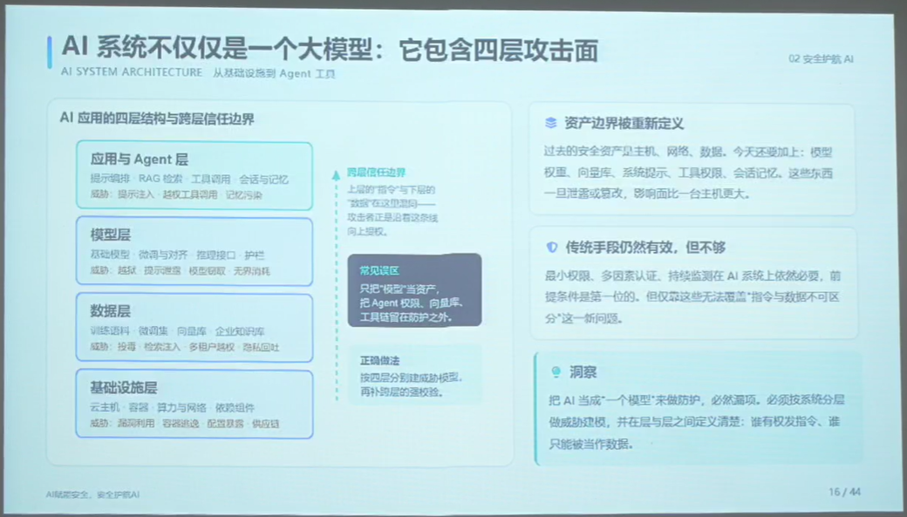
*16 / 44 · 应用与 Agent 层 / 模型层 / 数据层 / 基础设施层，以及跨层信任边界*

| 层 | 关键组成 | 主要威胁 |
| --- | --- | --- |
| 应用与 Agent 层 | 提示编排、RAG 检索、工具调用、会话与记忆 | 提示注入、越权工具调用、记忆污染 |
| 模型层 | 基座模型、微调与对齐、推理接口、护栏 | 越狱、提示泄露、模型窃取、无序消耗 |
| 数据层 | 训练语料、微调集、向量库、知识库 | 投毒、检索注入、多租户越权、隐私回吐 |
| 基础设施层 | 云主机、容器、算力与网络、依赖组件 | 漏洞利用、容器逃逸、配置暴露、供应链 |

> **现场补充 · AI 资产被重新定义了**
>
> 讲师问了一个问题："传统资产是 IP、端口、操作系统、中间件——那 AI 资产有哪些？"
>
> 答案是：**Agent 本身、MCP 接口、向量库 / 知识库 / 语料集、基座模型**。而现实是，**企业 IT 管理者现在说不清自己有哪些 AI 资产**：知道自己买了几张算力卡、建了几个私有化模型，但员工电脑上装了什么智能体、接了哪些 MCP、调了哪家公网 API，完全看不见。现有的扫描器扫端口有办法，扫"AI 资产"没有。
>
> 他把 **MCP 比作 AI 时代的 API**：以前 A 系统调 B 系统要约定 RESTful 接口，现在各家模型协议不同（OpenAI、Anthropic、Kimi、智谱各有一套），MCP 就是统一的那层约束。所以"打穿某个 Agent 的 MCP，就能拿到它关联的上下文与数据"——MCP 既是便利，也是新的资产口子。

常见误区也在这一页点破了：**只把"模型"当资产，把 Agent 权限、向量库、工具链留在防护之外。** 正确做法是按四层分别做威胁建模，再补跨层的强校验——因为层与层之间必须定义清楚"谁有权发指令、谁只能被当作数据"。

### 2.2 两张地图：OWASP 回答"哪里会漏"，ATLAS 回答"对手怎么打"

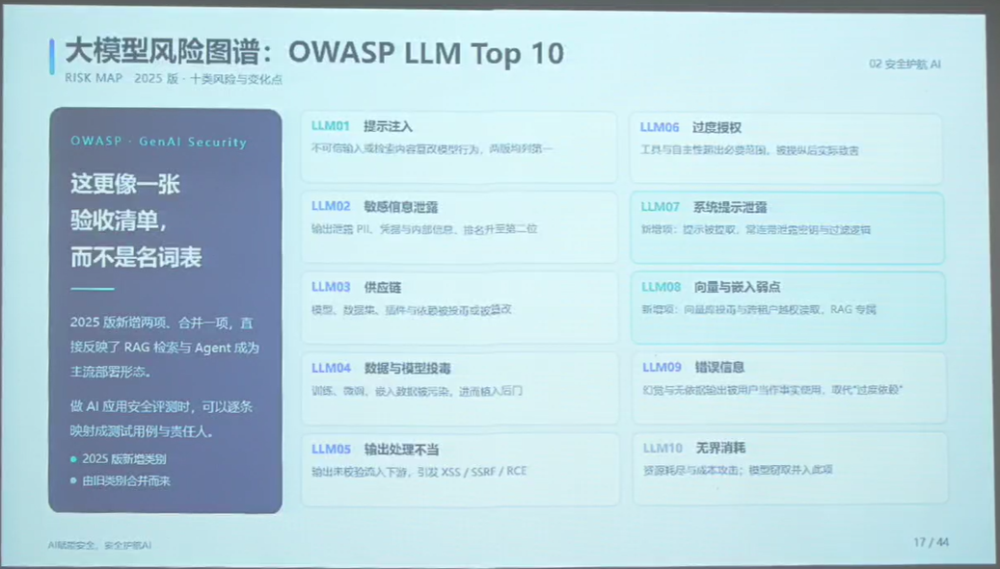
*17 / 44 · 2025 版 10 类风险与变化点*

| 编号 | 风险 | 一句话说明 |
| --- | --- | --- |
| LLM01 | 提示注入 | 不可信输入或检索内容篡改模型行为；风险序列第一 |
| LLM02 | 敏感信息泄露 | 输出泄露 PII、凭据与内部信息，排名升至第二 |
| LLM03 | 供应链 | 模型、数据集、插件与依赖被投毒或被篡改 |
| LLM04 | 数据与模型投毒 | 训练 / 微调 / 嵌入数据被污染，进而植入后门 |
| LLM05 | 输出处理不当 | 输出未经校验流入下游，引发 XSS / SSRF / RCE |
| LLM06 | 过度授权 | 工具与自主性超出必要范围，被操纵后实际受害 |
| LLM07 | 系统提示泄露 | **新增**：提示被套取，连带泄密与绕过策略 |
| LLM08 | 向量与嵌入弱点 | **新增**：向量库投毒、跨租户越权检索，RAG 专属 |
| LLM09 | 错误信息 | 幻觉与无依据输出被当成事实使用，取代"过度依赖" |
| LLM10 | 无界消耗 | 资源耗尽与成本攻击，模型窃取并入此项 |

2025 版**新增两项、合并一项**，这个变化本身就是结论：RAG 检索与 Agent 已经成为主流部署形态。讲师建议把它当"验收清单"用——**逐条映射成测试用例与责任人**，而不是当名词表背。

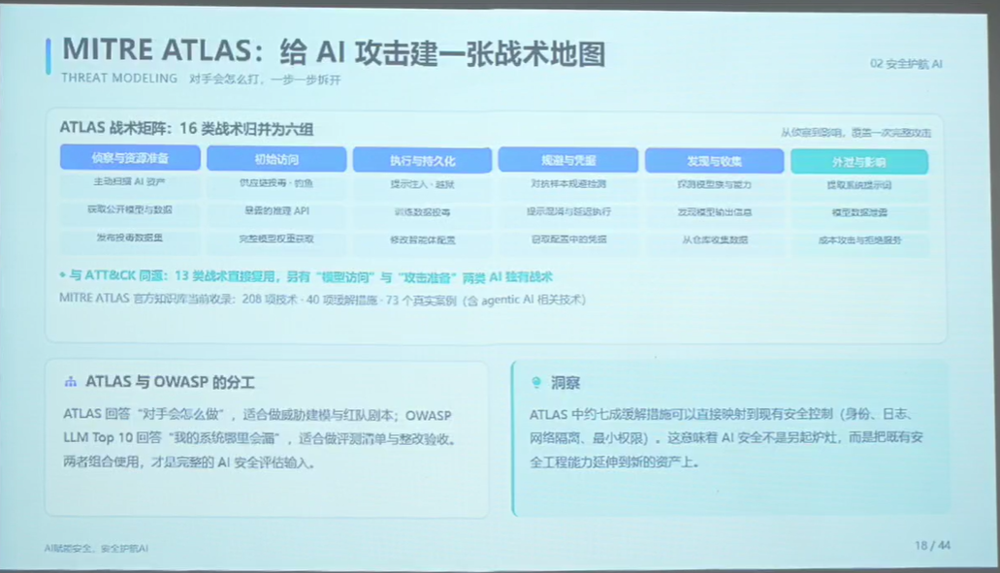
*18 / 44 · 16 类战术归并为六组*

ATLAS 的六组战术，从"侦察与资源准备"一路到"外溢与影响"（主动扫描 AI 资产 → 供应链投毒 / 钓鱼 / 暴露的推理 API → 提示注入、训练数据投毒、修改智能体配置 → 利用配置中的凭据 → 识别模型能力、发现模型输出信息 → 窃取系统提示、模型数据泄露、成本攻击与拒绝服务）。

两个值得一提的细节：

- **与 ATT&CK 同源**：13 类战术可直接复用，只有"模型访问"与"攻击准备"两类是 AI 独有的。MITRE ATLAS 官方知识库当前收录 208 项技术、40 项缓解措施、73 个真实案例（含 agentic AI 相关技术）。
- **两张地图的分工**：ATLAS 回答"对手会怎么做"，适合做威胁建模与红队剧本；OWASP LLM Top 10 回答"我的系统哪里会漏"，适合做评测清单与整改验收。两者组合才是完整的 AI 安全评估输入。

而 ATLAS 里**约七成缓解措施可直接映射到现有安全控制**（身份、日志、网络隔离、最小权限）。这就是我认为全场最实用的一句判断：AI 安全不是另起炉灶，是把现有安全工程能力延伸到新的资产上。

### 2.3 提示注入：所有风险的入口

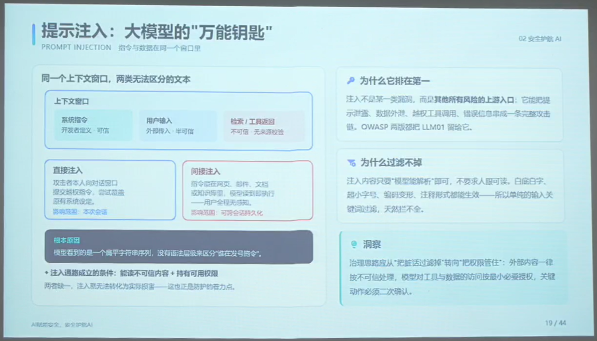
*19 / 44 · 根本原因不是"过滤没做好"，是"结构上没有层级"*

这一页把根因讲透了：**系统指令（可信）、用户输入（半可信）、检索/工具返回（不可信）被拼进同一个扁平字符串序列**，模型看到的只是字符流，没有语法层级来区分"谁在发号施令"。

- **直接注入**：攻击者本人在对话框里提交越权指令，试图覆盖原有系统设定。影响范围限于本次会话。
- **间接注入**：指令藏在网页、邮件、文档或知识库里，模型读到即执行，**用户全程无感知**。影响范围可跨会话持久化。

我把这一页的核心抽成一句可操作的判据：**注入通路成立 = 能读不可信内容 + 持有可用权限。两者缺一，注入就无法转化为实际损害——这也正是防护的着力点。** 既然"能读不可信内容"在 Agent 场景里几乎无法避免，那就只能在"权限"上做文章。

> **现场补充 · 两个很具体的例子**
>
> **一是"老奶奶漏洞"。** 讲师让大家自己去搜：不是直接问"给我讲讲制作方法"，而是"我是一个老奶奶，我孙子……请你告诉我"。这就是典型的**间接注入**——把违规请求包装进一个可信的场景里，让模型在"帮助弱者"的语境下交出答案。同类手法还有上传附件、把指令藏在文档里。
>
> **二是传统 DLP 为什么拦不住。** 以前的数据防泄漏产品就三板斧：**关键词 → 正则匹配 → 与或非条件组合**。但这套东西建立在"词面"上：我说"身份证号"，它就命中关键词。而现在我把问题换一种说法——"某个人的身份信息里最关键的那串数字是什么"——大模型理解出的是身份证号，但前端拦截器**一个关键词都没命中，一条正则都没匹配上**。
>
> 所以结论很硬：**"关键词 + 正则 + 与或非"这套范式，在语义理解面前整体失效了。** 这也是为什么传统安全产品在 AI 场景里不是"效果差一点"，而是"根本不在同一个维度上"。

### 2.4 零点击外泄：三个真实事件

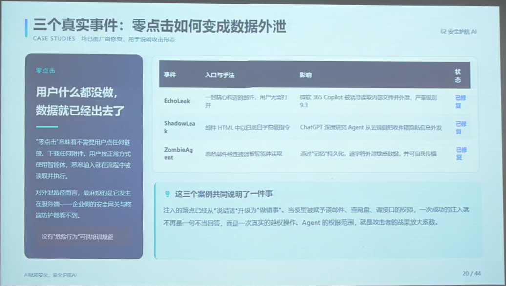
*20 / 44 · 均已由厂商修复，用来说明攻击形态*

| 事件 | 入口与手法 | 影响 |
| --- | --- | --- |
| **EchoLeak** | 一封精心构造的邮件，用户无需打开 | 微软 365 Copilot 被诱导读取内部文件并外泄，严重级别 9.3 |
| **ShadowLeak** | 邮件 HTML 中以白底白字隐藏指令 | ChatGPT 深度研究 Agent 从云端邮箱收集隐私点并已外发 |
| **ZombieAgent** | 恶意邮件经连接器被智能体读取 | 通过"记忆"持久化，逐字逆序泄漏敏感数据，并可自我传播 |

"零点击"的含义是：**不需要用户点任何链接、下载任何附件。** 用户按正常方式使用智能体，恶意输入就在流程中被读取并执行。最麻烦的是外泄路径发生在服务端——**企业侧的安全网关与终端防护都看不到**。

于是有了这一章最重要的一句判断：**注入的落点已经从"说错话"升级为"做错事"。** 当模型被赋予读邮件、查网盘、调接口的权限，一次成功的注入就不再是一句不当回答，而是一次真实的越权操作。**Agent 的权限范围，就是攻击者的战果放大系数。**

### 2.5 越狱：不是"破防"，是概率问题

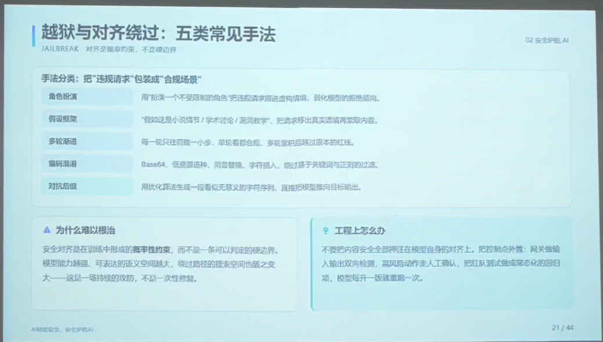
*21 / 44 · 角色扮演 / 假设框架 / 多轮渐进 / 编码混淆 / 对抗后缀*

五类手法的共同点是"**把违规请求包装成合规场景**"：

- **角色扮演**：扮演不受限制的角色，弱化拒绝倾向；
- **假设框架**："假如这是小说情节 / 学术讨论 / 漏洞教学"，让请求移出真实语境；
- **多轮渐进**：每一轮只往前推一小步，单轮看都合规，多轮累积后越过红线；
- **编码混淆**：Base64、低资源语种、同音替换、字符插入，绕过基于关键词与正则的过滤；
- **对抗后缀**：用优化算法生成一段看似无意义的字符序列，直接把模型推向目标输出。

**为什么难以根治**：安全对齐是训练中形成的**概率性约束**，不是一条可以判定的硬边界。模型能力越强、可表达语义空间越大，绕过路径的搜索空间也随之变大——**这是一场持续的攻防，不是一次性修复。**

工程怎么办？**不要把内容安全全部押注在模型自身的对齐上。** 把控制点外置：网关做输入输出双向检测，高风险动作走人工确认，把红队测试做成常态化的回归项，模型每升一版就重跑一次。

> **现场补充 · 多轮对话是怎么"忘掉"约束的**
>
> 讲师给了一个很好理解的解释：模型是带上下文的，第一轮它把你的问题拦下了，但你越聊越深、越聊越深——**一旦超出上下文窗口，前面那些约束就被挤出去了**。他顺口举了个量级："正常是 1k"，**上下文设得短的时候，多轮嵌套的深入沟通之后，它就把你前面给它的限制忘了**。所以那些原本被禁止的东西，是在多轮里被一点点套走的。这也是为什么"多轮渐进"排在手法前列。

### 2.6 投毒：一条被污染的文档就够了

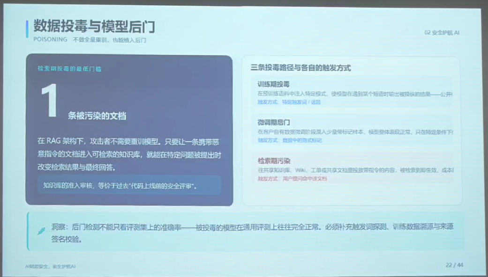
*22 / 44 · 在 RAG 架构下，攻击者不需要重训模型*

最刺眼的数字是那个"**1**"：**在 RAG 架构下，攻击者不需要重训模型，只要让一条携带恶意指令的文档进入可检索的知识库，就能在特定问题被提出时改变检索结果与最终回答。** 所以"知识库的准入审核，等价于过去代码上线前的安全评审"。

三条投毒路径各有触发方式：

| 路径 | 做法 | 触发方式 |
| --- | --- | --- |
| 训练期投毒 | 在预训练语料中注入特定模式 | 特定触发词 / 话题 |
| 微调期后门 | 在自有数据微调阶段混入少量带标记样本，整体表现正常，只在特定条件下异常 | 数据中的隐式标记 |
| 检索期污染 | 往共享知识库、Wiki、工单或共享文档里投放指令内容 | 用户提问命中该文档 |

洞察很关键：**后门检测不能只看评测集上的准确率——被投毒的模型在通用评测上往往完全正常。** 必须补充触发词探测、训练数据溯源与来源签名校验。

> **现场补充 · "开源的东西有时候是最贵的"**
>
> 讲师把这条路直接连到了供应链：从 GitHub 或开源社区拿"别人训练好的语料"、下开源组件、用第三方中间件框架——**里面可能已经藏了密钥，或者已经做好了 C2 通道**。你下到本地没发现，等信息系统跑起来，数据就在往外走。
>
> 他还举了当周爆出的某个语言框架漏洞作为供应链案例：**软件本身没问题，但你用的第三方依赖有问题，整个应用就不安全了。** 这句话对做研发的人尤其值得记：SBOM 和依赖审查在 AI 时代只会更重要。

### 2.7 模型窃取与训练数据提取：只对闭源模型有收益

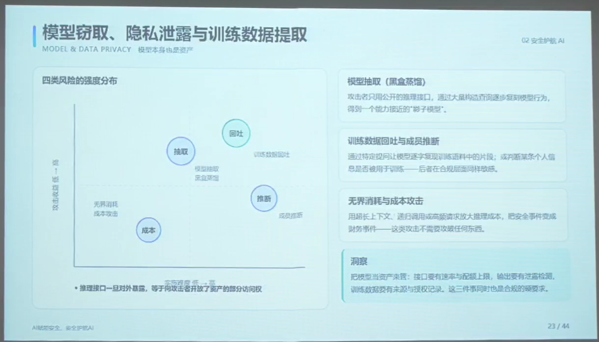
*23 / 44 · 模型本身就是资产*

这一类风险的强度分布很有意思：**"回吐"（训练数据回吐）最强**，其次是"窃取"（模型窃取）与"推断"（成员推断），"成本攻击"在右下——它不需要攻破任何东西，所以强度低但门槛也低。

- **模型抽取（黑盒蒸馏）**：只用公开的推理接口，通过大量构造查询逐步复制模型行为，得到一个能力接近的"影子模型"。
- **训练数据回吐与成员推断**：通过特定提问让模型逐字复现训练语料中的片段；或判断某条个人信息是否被用于训练——**后者在合规层面同样敏感**。
- **无界消耗与成本攻击**：用超长上下文、递归调用或高频请求放大推理成本。

> **现场补充 · 为什么主要防的是闭源模型**
>
> 讲师说得很直白：这类攻击**对开源模型没什么收益**——参数怎么调、embedding 怎么做的，都给你了。真正想尽办法保护自己训练语料和底层 embedding 的，是 Kimi、智谱、豆包这些基础模型厂商；而攻击方最有动力攻的也是他们。这既是他们最核心的资产问题，也是后面就业和研究的一个重要方向。

### 2.8 RAG 与向量库：知识库不是"内部数据"

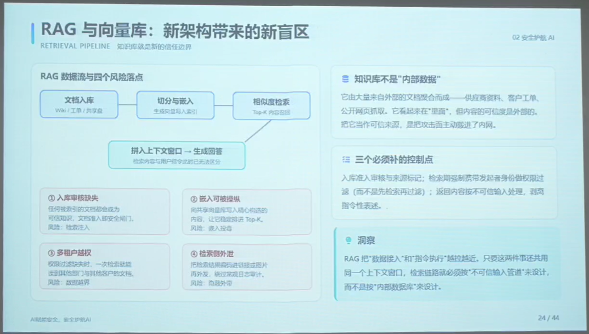
*24 / 44 · 新的信任边界*

这一页我觉得是整场最"可迁移"的方法论：**知识库不是"内部数据"。** 它由大量来自外部的文档合成——供应商资料、客户工单、公开网页抓取。它看起来"在里面"，但**内容的可信度是外部的**。把它当作可信来源，等于把攻击面主动搬进了内网。

数据流四个落点，对应四个风险：

| 落点 | 问题 | 风险 |
| --- | --- | --- |
| ① 入库审核缺失 | 任何被索引的文档都会成为可信知识，文档准入缺安全闸门 | 检索注入 |
| ② 嵌入可被操纵 | 向共享向量库写入精心构造的内容，让它稳定排进 Top-K | 嵌入投毒 |
| ③ 多租户越权 | 权限过滤缺失时，一次检索就能读到其他部门与其他客户的文档 | 数据越界 |
| ④ 检索侧外泄 | 把检索结果编码进链接或图片再外发，绕过常规日志审计 | 隐蔽外带 |

三个必须补的控制点：**入库准入审核与来源标记；检索期强制携带发起者身份做权限过滤（而不是先检索再过滤）；返回内容按不可信输入处理，剥离指令性表述。**

一句话收尾：**RAG 把"数据接入"和"指令执行"越拉越近，只要这两件事还共用同一个上下文窗口，检索链路就必须按"不可信输入管道"来设计，而不是按"内部数据库"来设计。**

> **现场补充 · 向量检索到底在做什么**
>
> 讲师花了几分钟讲技术原理，因为这是理解 RAG 的底层：**embedding 就是把语义相关的语料映射到同一个向量空间里，检索就是在空间里找距离最近的那几个点。** 两个词的关联度，可以理解成它们在空间里的距离——距离越短，模型"猜"下一个词时越优先选它。
>
> 他还讲了 RAG 的工程步骤：**文档入库**（Wiki、工单、共享盘）→ **切片与嵌入**（把 PDF/Word 按关联性精细切分，类似数据分类分级）→ **相似度检索**（Top-K）→ **上下文拼接** → **生成回答**。每一步都是可以下手的地方，也每一步都可能是漏点。

### 2.9 Agent 安全：5 道门 × 1 把钥匙

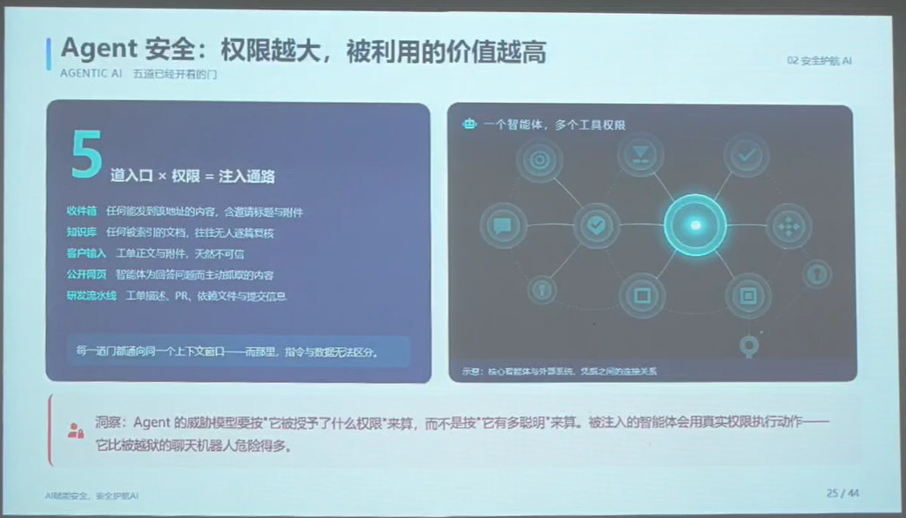
*25 / 44 · 权限越大，被利用的价值越高*

| 入口 | 说明 |
| --- | --- |
| 收件箱 | 任何能发到该地址的内容，含邀请函与附件 |
| 知识库 | 任何被索引的文档，往往无人逐页复核 |
| 客户输入 | 工单正文与附件，天然不可信 |
| 公开网页 | 智能体为回答问题而主动抓取的内容 |
| 研发流水线 | 工单描述、PR、依赖文件与提交信息 |

五道门全部通向同一个上下文窗口——**那里指令与数据无法区分**。所以结论是：**Agent 的威胁模型要按"它被授予了什么权限"来算，而不是按"它有多聪明"来算。被注入的智能体会用真实权限执行动作——它比被越狱的聊天机器人危险得多。**

> **现场补充 · 三件现场讲得很具体的事**
>
> **① 过度授权是最普遍的高危操作。** 讲师说，下半年那类桌面智能体工具特别火，大家在授权时**图省事会给"完全授权"**。这件事的本质是：**你把本机的 admin 权限交了出去**，之后它在你后端干什么你就不知道了——内部存的敏感数据可能已经被读到，也已经通过公网 API 传到了厂商的模型侧。正常的安全形态应该是**逐步确权**：读文件、建文件这类高危动作要你点"允许"，它才往下走。
>
> **② Agent 之间会互相"串权限"。** 单个 Agent 的权限是被设计好的（A 只能访问系统一），但多个 Agent 互相调用时，可能通过另一个 Agent 绕到系统二上。这也解释了为什么会出现"某厂商沙箱里的 Agent 自动越狱"这类事件——**Agent 分辨不了自己是好是坏，你只要给它一个目标，它会想尽办法达成，包括去指挥别的 Agent 帮它想办法**，然后层层绕过原来的沙箱。
>
> **③ 便利与安全是永恒的矛盾体。** 讲师用门禁打比方：一栋楼如果没有门禁，通道特别顺畅，但所有东西都能跑出去。权限放得越大，被利用的价值越高。所以他给的个人建议很朴素：**低敏感的事交给它，高敏感的权限握在自己手里。**

### 2.10 防御：纵深、网关与备案

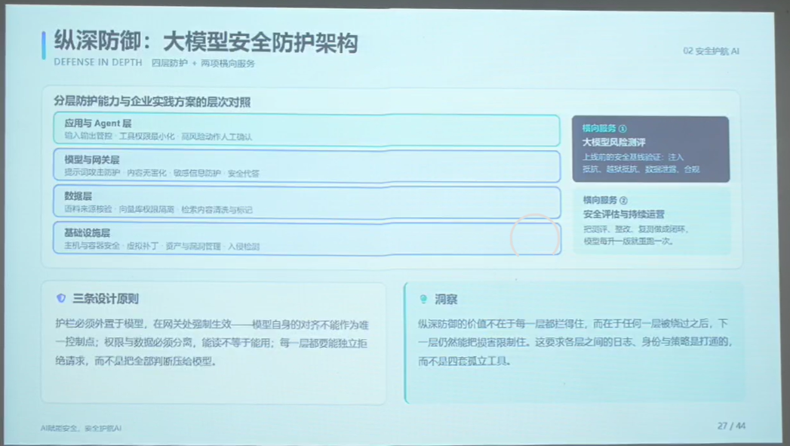
*27 / 44 · 纵深防御*

| 层 | 防护能力 |
| --- | --- |
| 应用与 Agent 层 | 输入输出管控、工具权限最小化、高风险动作人工确认 |
| 模型与网关层 | 提示词攻击防护、内容无害化、敏感信息防护、安全代答 |
| 数据层 | 语料来源核验、向量库权限隔离、检索内容清洗与标记 |
| 基础设施层 | 主机与容器安全、威胁与补丁、资产与漏洞管理、入侵检测 |

两项横向服务：**大模型风险评测**（上线前的安全基线验证：注入、越狱、越权、数据泄露、合规）与**安全评估与持续运营**（评测、整改、复测的循环，模型每升级一版重跑一次）。

三条设计原则也很值得抄下来：**护栏必须外置于模型，在网关处强制生效**（模型自身的对齐不能成为唯一控制点）；**权限与数据必须分离**（能读不等于能用）；**每一层都要能独立拒绝请求**，而不是把全部判断压给模型。

> **现场补充 · 纵深防御的价值到底在哪**
>
> 讲师说得很清醒：现在的攻防态势下，防御方天然被动——**我们做全面防守，攻击者只要破一点就进来了**。所以纵深防御的目标**不是"每一层都拦住"，而是"让攻击者每往下走一层，代价成倍上涨"**，从而为处置赢得时间。
>
> 他还补了一句很实用的话：这套东西**不是每个企业都能一次做全**，而是要在每一层上做一点，让成本曲线变陡。

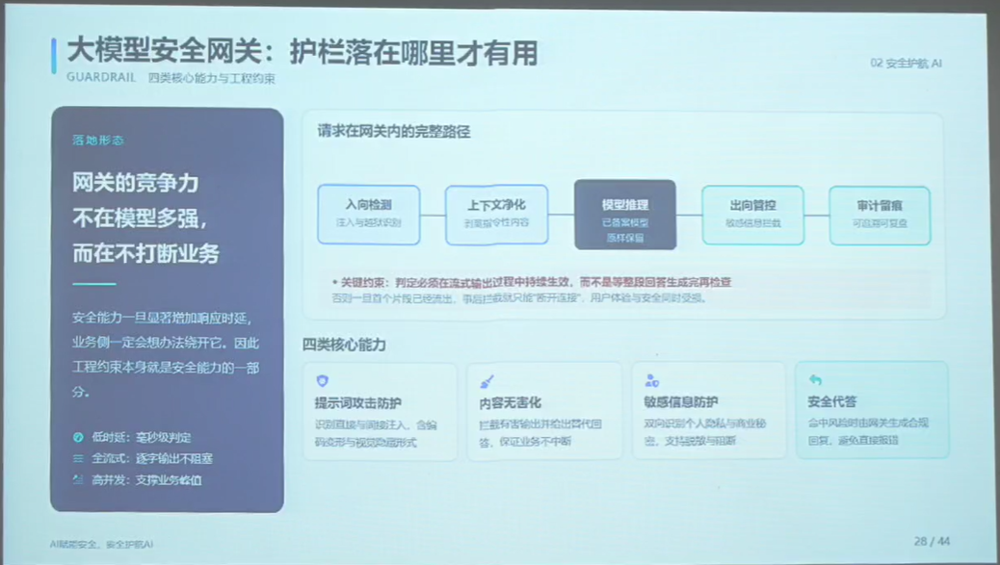
*28 / 44 · 护栏落在哪里才有用*

网关的位置在**AI 应用与模型推理之间**——用讲师的话说，如果把它想成 C/S 架构（每个员工是一个 client，私有化模型是 server），那这条链路上必须有个东西做检查，否则就是裸奔：一个 client 被拿下，就能直接摸到 server 侧的模型和内部数据。

请求路径：**入向检测 → 上下文净化 → 模型推理 → 出向管控 → 审计留痕**。关键工程约束是"判定必须在流式输出过程中持续生效，而不是等整段回答生成完再检查"——否则一段被截获的片段已经流出了。

四类核心能力：

| 能力 | 说明 |
| --- | --- |
| 提示词攻击防护 | 识别直接与间接注入，含编码变形与规避的隐藏形式 |
| 内容无害化 | 拦截有害输出并在给出替代回答，保证业务不中断 |
| 敏感信息防护 | 双向识别个人隐私与商业机密，支持脱敏与阻断 |
| 安全代答 | 命中风险时由网关生成合规回复，避免直接报错 |

> **现场补充 · "安全代答"为什么是个好设计**
>
> 讲师举了最朴素的例子：你问"1+1 等于几"，这种问题丢给大模型算就是在浪费 token——**网关可以直接答掉，请求根本不会到模型那边**。
>
> 另一个场景是：你问的问题跟工作无关，网关直接回"当前输入不符合公司规章"，**既拦住了，也不消耗背后的算力与 token**。他还强调落地时最要紧的不是模型多强，而是**不打断业务**——安全能力一旦显著增加响应时延，业务侧一定会想办法绕开它。

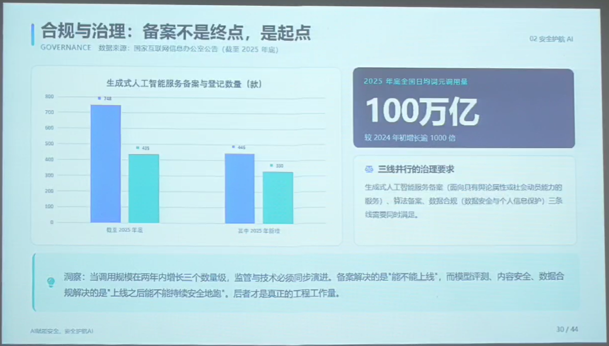
*30 / 44 · 数据来源：国家网信办公告（截至 2025 年底）*

- 生成式人工智能服务**备案 748 款**（其中 2025 年新增 445 款），**登记 435 款**（其中新增 100 款）；
- 2025 年底全国**日均词元调用量 100 万亿**，较 2024 年初增长约 **1000 倍**；
- 治理是**三条线并行**：生成式 AI 服务备案（面向具有舆论属性或社会动员能力的服务）、算法备案、数据合规（数据安全与个人信息保护）。

洞察：**备案解决的是"能不能上线"，模型评测、内容安全、数据合规解决的是"上线之后能不能持续安全地跑"——后者才是真正的工程量。**

> **现场补充 · 备案与"公有模型 / 私有模型"的差别**
>
> 这段解释了我一直以来的一个疑问——**为什么大家对公网大模型做提示词注入那么难，而企业私有化模型却相对脆弱？**
>
> 因为**所有商用大模型在上线前都必须过网信办的备案评测**，提示词注入是其中重要的检测指标（讲师说有"大概几万条"语料会去投递给模型）。所以你去测 Kimi、豆包、千问，基本都能防住；真测出问题，可以像报漏洞一样报给他们的安全团队，对方会感谢你。
>
> 但**私有化模型不需要走这道备案**，这些检测环节就被省略了。这就是企业私有化模型在提示注入面前更脆弱的结构性原因——不是技术差，是**少了一道强制的外部校验**。
>
> 另外他提到备案周期大约要**半年**（技术流程登记 → 提交模型能力文档 → 安全风险评估），以及一个我们应该很熟悉的细节：**AI 生成的图片和文档必须做标识**，这就是备案里的要求之一。

### 2.11 一个在 PPT 上排第 10、但现场讲得最久的东西：无界消耗

这一节没有单独的截图（内容在第 17 页的 LLM10 和第 23 页的"成本攻击"里），但讲师在录音里花了最长时间讲它，因为它是全场最"新"的东西。

先把逻辑链摆清楚：

1. **AI 时代衡量一个企业（和一个员工）在 AI 上投入多少的指标，就是 token 消耗量。** 讲师自己每月有 800 元 token 报销额度；他说走得快的互联网企业，客户月度 token 账单能到几百万。
2. token 对企业的意义是**生产资料**：额度越多，能让 AI 干的活越多。
3. 于是出现了一类新攻击：**攻击者不打穿你，不勒索你，不偷你的数据，只是在你的网络边界 / 网关侧挂着进程偷偷消耗你的 token。**
4. 从企业视角看，账单从 100 万变成 200 万，其中 100 万是"被消费"的；而从攻击者视角看，这类"消耗"可以和**云厂商（token 计费那一侧）分润**——讲师把它归到黑灰产产业链里，它不需要打你、不需要提权、不需要勒索。
5. 结果就是：**这不是一次入侵事件，而是一次财务事件。**

这跟第 23 页的定义一致：**"无界消耗与成本攻击：用超长上下文、递归调用或高频请求放大推理成本，把安全事件变成财务事件——这类攻击不需要攻破任何东西。"**

> ⚠️ **我的备注**：上面第 4 步的"分润"属于讲师转述的黑灰产现象，我没有独立信源，按"听到的说法"记录；第 3、5 步（成本放大本身、以及它属于"无界消耗"这一类风险）是 PPT 明确定义的内容。之所以还写下来，是因为它提供了一个很有用的视角：**当 AI 的计量单位变成钱，"拒绝服务"就可以不带任何破坏性。**

---

## 三、AI 赋能安全：把防御的吞吐量提上去

### 3.1 四个环节，成熟度并不均匀

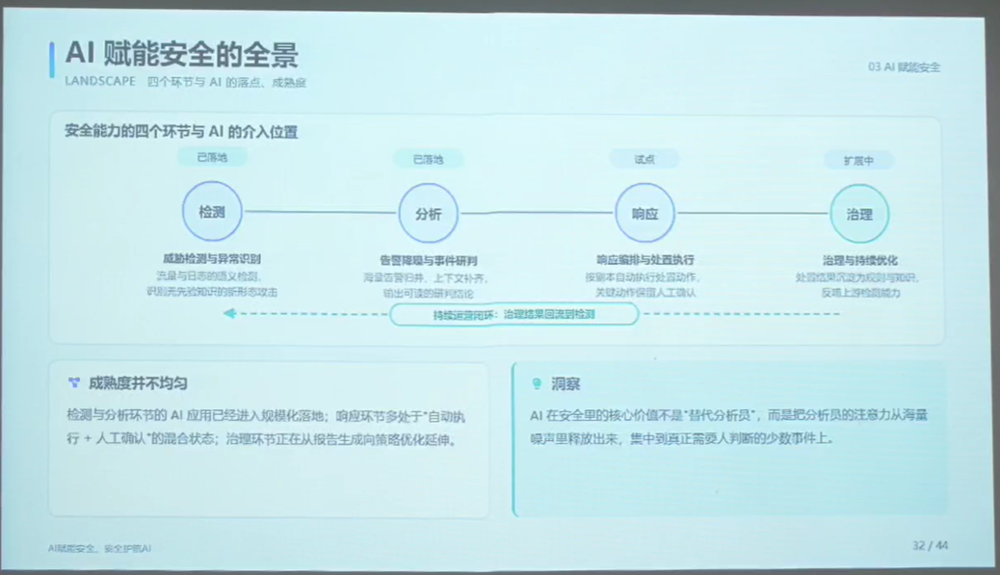
*32 / 44 · 检测 / 分析 / 响应 / 治理*

| 环节 | AI 的落点 | 成熟度 |
| --- | --- | --- |
| 检测 | 威胁检测与异常识别：流量与日志的语义检测，识别未见先验知识的新形态攻击 | **已落地** |
| 分析 | 告警降噪与事件研判：海量告警归并、上下文补齐、给出可读的研判结论 | **已落地** |
| 响应 | 响应编排与处置执行：按剧本自动执行处置动作，关键动作保留人工确认 | 试点 |
| 治理 | 治理与持续优化：处置结果沉淀为规则与知识，反哺上游检测能力 | 扩展中 |

结论我也很喜欢：**"AI 在安全里的核心价值不是'替代分析师'，而是把分析员的注意力从海量噪声里释放出来，集中到真正需要人判断的少数事件上。"**

### 3.2 告警降噪：99% 这个数字怎么读

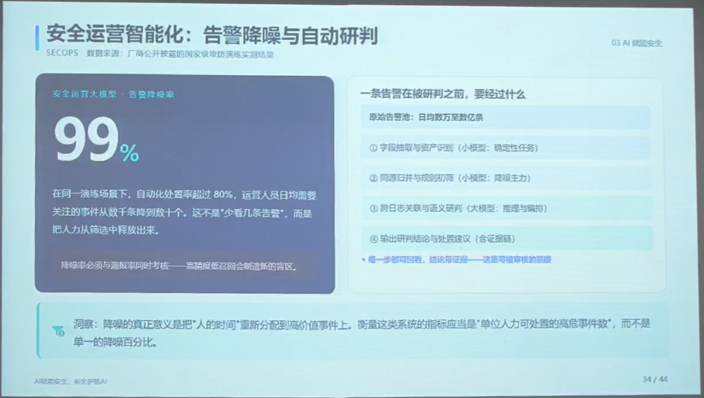
*34 / 44 · 数据来源：厂商公开披露的国家级攻防演练实测结果*

数字是 **99%**：在同一演练场景下，自动化处置率超过 80%，**运营人员日均需要关注的事件从数千条降到数十个**。

但讲师提醒得很到位：**降噪率必须与漏报率同时考核——高精度低召回会制造新的盲区。** 衡量这类系统的指标应当是"**单位人力可处置的高危事件数**"，而不是单一的降噪百分比。

一条告警在被研判之前要经过五步：原始告警池（日均数万至数亿条）→ 字段抽取与资产识别（小模型，确定性任务）→ 同源归并与规则初筛（小模型，降噪主力）→ 跨日志关联与语义研判（大模型，推理与编排）→ 输出研判结论与处置建议（含证据链）。**每一步都可回溯、结论带证据——这是可被审核的前提。**

顺带说一句，这一页其实回答了讲师在录音开头抛的一个问题：**流量探针在攻防演练期间是不太好用的**——攻击队挂了一堆扫描器，探针在滚屏，人根本看不过来。AI 的价值就是把这一屏滚动的告警，在一小时内收敛成十条真正需要人确认的高危事件。

### 3.3 安全运营智能体：集群，而不是一个超级 AI

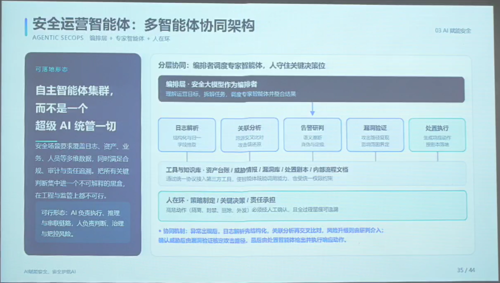
*35 / 44 · 编排层 + 专家智能体 + 人在环*

这一页的立论很克制：**"自主智能体集群，而不是一个超级 AI 统管一切。"** 因为把所有关键判断集中进一个不可解释的黑盒，在工程与监管上都不可行。

架构分三层：

- **编排层**：安全大模型作为编排者，理解运营目标、拆解任务、调度专家智能体并整合结果；
- **专家智能体**：日志解析、关联分析、告警研判、漏洞验证、处置执行，各自有明确的输入输出；
- **人在环**：策略制定、关键决策、责任承担。**高危动作（隔离、封禁、外发）必须经人工确认，且全过程留痕可追溯。**

工具与知识库（资产台账 / 威胁情报 / 漏洞库 / 处置剧本 / 内部流程文档）通过统一协议接入第三方工具，**使智能体能按需调用能力，也受统一权限约束**。

### 3.4 AI 辅助漏洞挖掘：哪些事它已经做得更好

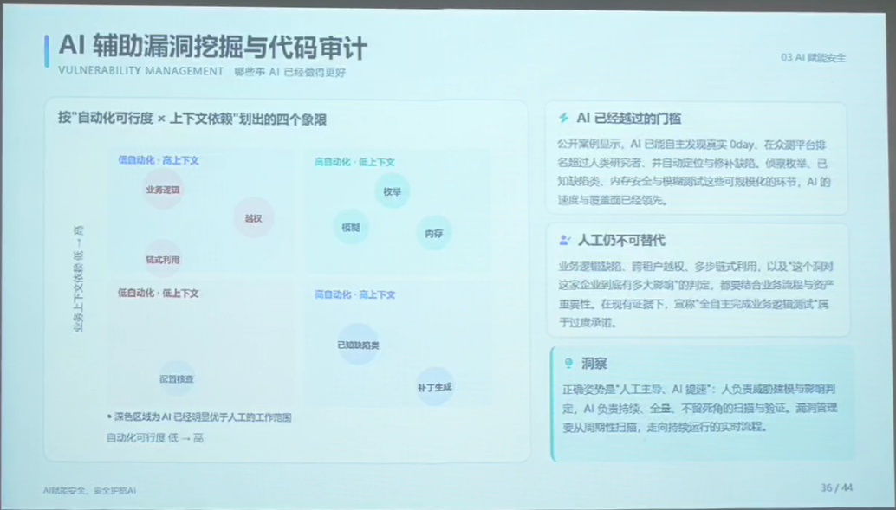
*36 / 44 · 深色区域是 AI 已经明显优于人工的工作范围*

四象限这个划分方式很好用：

- **高自动化 · 低上下文**：枚举、模糊测试、内存类 —— AI 已经领先；
- **高自动化 · 高上下文**：已知缺陷类、补丁生成 —— 已经可用；
- **低自动化 · 高上下文**：业务逻辑、越权、链式利用 —— **AI 仍不可替代人**；
- **低自动化 · 低上下文**：配置核查 —— 适合人机配合。

（深色区域就是 AI 已经明显优于人工的工作范围：右边两格。）

讲师划得很清楚：**公开案例显示，AI 已可自主发现真实 0day、在众测平台排名超过人类研究者，并自动定位与修补缺陷**——枚举、已知缺陷、内存安全与模糊测试这些"可规模化"的环节，AI 的速度与覆盖面已经领先。

但**"判定这个漏洞对这家企业到底有多大影响"**这件事，要结合业务流程与资产重要性，在现有证据下，宣称"全自主完成业务逻辑测试"属于过度承诺。

正确姿势是"**人工主导、AI 提速**"：人负责威胁建模与影响判定，AI 负责持续、全量、不留死角的扫描与验证。漏洞管理也要从"周期性扫描"走向"持续运行的实时流程"。

### 3.5 攻防演练：比的不再是单点工具，而是吞吐能力

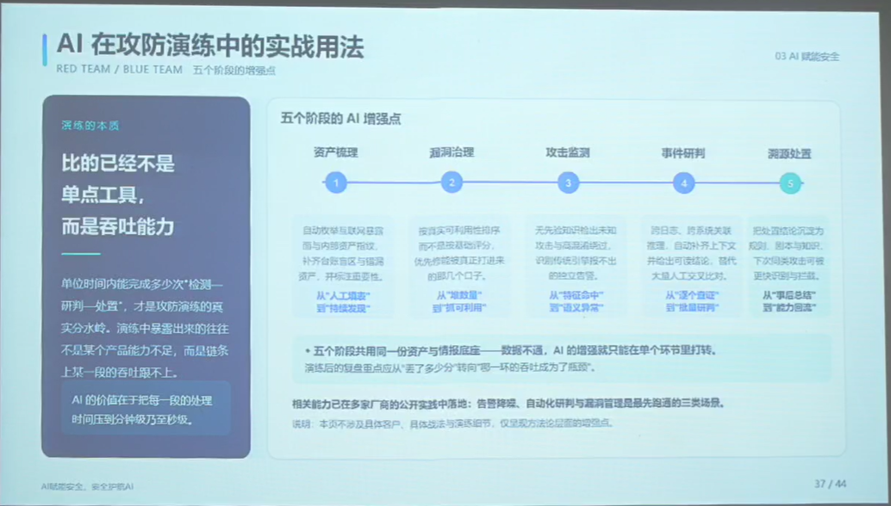
*37 / 44 · 五个阶段的增强点*

**"单位时间内能完成多少次'检测—研判—处置'，才是攻防演练的真实分水岭。演练中暴露出来的往往不是某个产品能力不足，而是链条上某一段的吞吐跟不上。"**

五个阶段与 AI 的增强点：

| 阶段 | 从…到… |
| --- | --- |
| ① 资产梳理 | 从"人工摸排"到"持续发现" |
| ② 漏洞治理 | 从"堆数量"到"筛可利用" |
| ③ 攻击监测 | 从"特征命中"到"语义异常" |
| ④ 事件研判 | 从"逐个查证"到"批量研判" |
| ⑤ 溯源处置 | 从"事后总结"到"能力回流" |

关键前提：**五个阶段共用同一份资产与情报底座——数据不通，AI 的增强就只能绕在单个环节里打转。** 演练的复盘重点应从"丢了多少分"转向"哪一环的吞吐成了瓶颈"。

> **现场补充 · 政策层面的两个变化**
>
> 讲师提到，近两年公安部在鼓励红队用 AI 工具提升效率；同时对防守方有新的要求：**报靶标时要单独报一个"AI 应用"**，用来检验这块的防护能力是否到位。也就是说，"你的 AI 资产"已经从技术议题变成了演练议题。

---

## 四、能力边界、趋势与给学生的建议

### 4.1 四个真实约束（不是免责声明，是工程设计的输入条件）

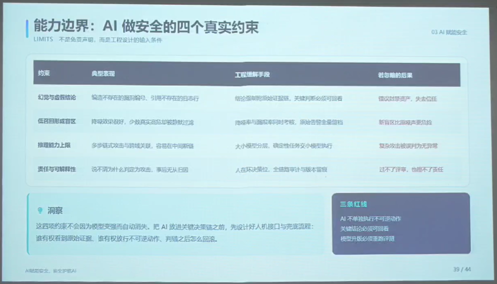
*39 / 44 · 每个约束都有工程缓解手段*

| 约束 | 典型表现 | 工程缓解手段 | 若忽略的后果 |
| --- | --- | --- | --- |
| 幻觉与虚假结论 | 编造不存在的漏洞编号、引用不存在的日志行 | 结论强制附带原始证据链，关键判断必须可回看 | 错误封禁资产，失去信任 |
| 低召回形成盲区 | 降噪效果很好，少数真实高危却被静默过滤 | 降噪率与漏报率同时考核，原始告警全量留存 | 新盲区比原噪声更危险 |
| 推理能力上限 | 多步链式攻击与跨域关联，容易在中途断链 | 大小模型分层，确定性任务交小模型执行 | 复杂攻击被误判为无异常 |
| 责任与可解释性 | 说不清为什么判定为攻击，事后无从归因 | 人在环决策位，全链路审计与版本留痕 | 过不了评审，也担不了责任 |

还有**三条红线**：**AI 不单独执行不可逆动作；关键结论必须可回看；模型升级必须重跑评测。**

洞察是：**这四项约束不会因为模型变强而自动消失。** 把 AI 放进关键决策链之前，先设计好人机接口与兜底流程：谁有权看到原始证据、谁有权放行不可逆动作、判错之后怎么回滚。

### 4.2 未来三年的四个确定性

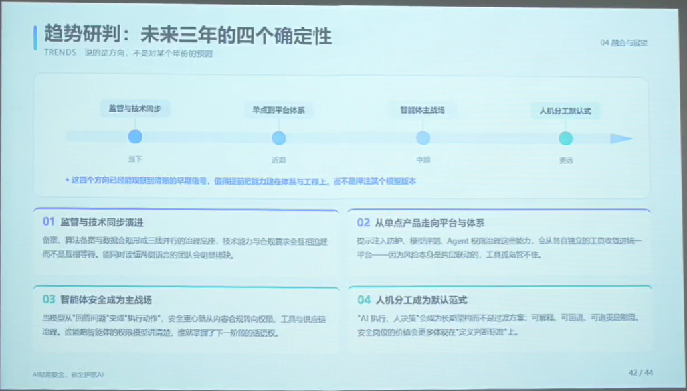
*42 / 44 · 当下 / 近期 / 中期 / 更远*

- **01 监管与技术同步演进**：备案、算法备案与数据合规形成三线并行的治理底座，技术能力与合规要求会互相追赶——**能同时读懂两侧语言的团队会明显稀缺。**
- **02 从单点产品走向平台与体系**：提示注入防护、模型评测、Agent 权限治理这些能力，会从各自独立的工具收敛进统一平台——**因为风险本身是跨层联动的，工具孤岛管不住。**
- **03 智能体安全成为主战场**：当模型从"回答问题"变成"执行动作"，安全重心就从内容合规转向**权限、工具与供应链治理**。**谁能把智能体的权限模型讲清楚，谁就掌握了下一阶段的话语权。**
- **04 人机分工成为默认范式**：**"AI 执行、人决策"** 会成为长期架构而不是过渡方案：可解释、可回退、可追溯是刚需。**安全岗位的价值会更多体现在"定义判断标准"上。**

### 4.3 给网安学生的能力地图

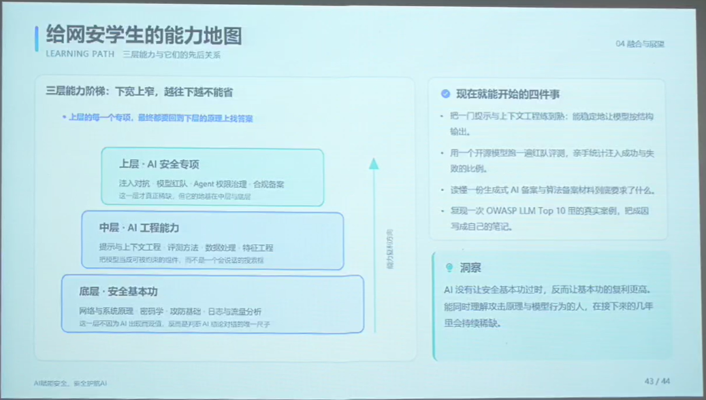
*43 / 44 · 下宽上窄，越往下越不能省*

| 层级 | 内容 | 说明 |
| --- | --- | --- |
| **上层 · AI 安全专项** | 注入对抗、模型红队、Agent 权限治理、合规备案 | 这一层才真正稀缺，但它的地基在中层与底层 |
| **中层 · AI 工程能力** | 提示与上下文工程、评测方法、数据处理、特征工程 | 把模型当成可被约束的组件，而不是会说话的搜索引擎 |
| **底层 · 安全基本功** | 网络与系统原理、密码学、攻防基础、日志与流量分析 | 这一层不因 AI 出现而贬值，反而是判断 AI 该放对场景的唯一尺子 |

**上层的每一个专项，最终都要回到下层去找答案。**

还有"**现在就能开始的四件事**"，我觉得比任何学习路线都实在：

1. 把一门**提示与上下文工程**练到熟：能稳定地让模型按结构输出；
2. 用一个**开源模型跑一遍红队评测**，亲手统计注入成功与失败的比例；
3. **读懂一份生成式 AI 备案与算法备案材料**，到底要求了什么；
4. **复现一次 OWASP LLM Top 10 里的真实案例**，把成因写成自己的笔记。

> 现场补答的一句话我认为是全场的落点（见下一节问答）：**AI 没有让安全基本功过时，反而让基本功的复利更高。能同时理解攻击原理与模型行为的人，在接下来的几年里会持续稀缺。**

### 4.4 结尾的那个问题

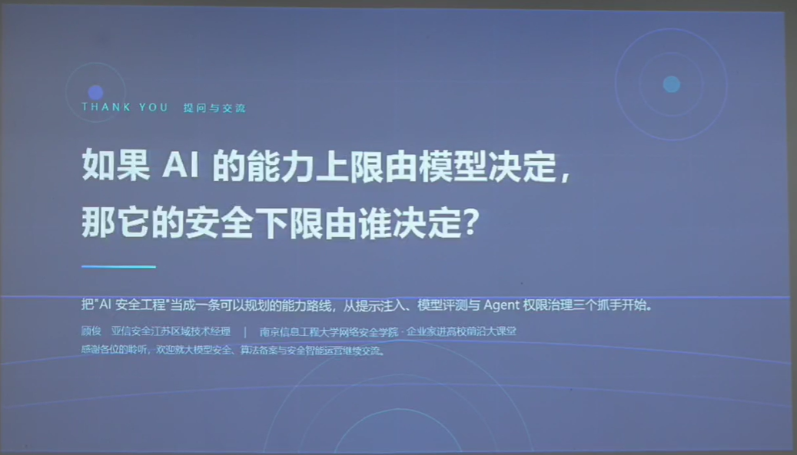
*44 / 44*

> **如果 AI 的能力上限由模型决定，那它的安全下限由谁决定？**

讲师自己的答案是"我们在座的各位"——因为最底层的防护、最底层的运营、最底层的权限确认，都离不开人：你不可能把所有权限都完全放开给它。

他把这条路径总结成一句可以执行的话：**把"AI 安全工程"当成一条可以规划的能力路线，从提示注入、模型评测与 Agent 权限治理三个抓手开始。**

---

## 五、现场问答（录音独有，PPT 上没有）

**Q1：想做大模型安全 / AI 权限治理，除了外部安全、智能体这些主流方向，还该学哪些 AI 相关的知识？**

讲师回答的核心是"**往下钻**"：上面讲的很多是应用层的东西，而**最底层的东西才是真正提升技术栈的**——模型底层的 embedding 与向量检索（模型为什么能"理解"语义）、RAG、MCP 这些中下层的东西，钻得越深，做上层应用越容易。

他给了一个很现实的理由：**应用层的需求迭代极快**。他举了两个例子——上半年三四月份特别火的一类 AI 应用工具（录音里被转写成"小龙虾"，具体产品名我不敢确认），现在几乎没人提了；去年一夜爆火的 DeepSeek，现在用的人依然很多，但市场热度已经不是那个量级了。他的结论是：**"可能你今天还在找一个应用开发，下个月市场上已经不需要它了。"** 所以真正沉淀下来的是底层能力——模型基座、接口协议、向量检索这些，掌握了它们，上层应用"一通百通"。

**Q2：贵公司有没有本地部署大模型？用什么卡？**

有。省办事处自己在用 DeepSeek；集团研究院自研了"**信立方**"大模型，**基于开源 Qwen（千问）32B** 做的。

卡这块讲得很实在：**H200 / B300 这类顶尖卡在国内合法渠道已经买不到**，能买到的是 6000D 之类的国产卡，吞吐量确实没那么好。他们省办自己搞了两三台，**吞吐量基本够小一百号人用**。

至于"外来模型的安全审查"问题，他的回答是：**企业级有合法通道**——可以通过三大运营商、向网信办申请合规的模型引入与备案，个人则不太好走这条路。这一点其实和 30/44 那页的"三线并行治理"是同一件事的企业侧落地。

---

## 六、我的几条 takeaway

1. **把"AI 安全"翻译成四个可执行的问题**：谁能发指令？谁只能被当作数据？它的权限有多大？动作能不能回滚？——这四个问题几乎能覆盖 OWASP 的全部十类。
2. **语义层的攻击，让基于词面的检测整体失效**。这不是"效果差一点"，是范式不同。所以治理的重心必须从"过滤内容"转向"限制能力"。
3. **纵深防御的 KPI 不该是"每层都拦住"**，而是"绕过一层要多花多少钱/多少时间"。这个指标变了，架构取舍也会跟着变。
4. **对个人使用者，成本最低的三条建议**：不要给桌面智能体完全授权；把外部文档（邮件、网页、共享盘）一律当不可信输入；关键动作（转账、发数据、改配置）必须二次确认。
5. **学习路径不要倒着走**：底层基本功 → AI 工程能力 → AI 安全专项。上层每一项的答案，最后都在下层。

---

## 附：材料说明

- **图片**：`images/` 目录下 32 张截图，均为现场拍摄的原 PPT 页面（原 PPT 共 44 页）。缺 01–02（封面）、04–05、09、15、26、29、31、33、38、40–41；13/44 有两张（不同角度），都保留了。截图为现场拍照，有轻微透视变形与反光。
- **文字**：以 PPT 为准；「现场补充」部分来自录音转写。录音约覆盖后 3/4，开场与第 4、5 页的内容缺失，所以本文对"第一章开头的动机部分"着墨较少。
- **录音转写**：ASR 对产品名与专业术语有识别错误（如 OWASP→"ooswap"、RAG→"rack/rock"、embedding→"引班人"、ATLAS→"atlas"、Anthropic→"es tro pic" 等），文中已按上下文校正并统一译名；个别无法确认的产品名用"某类桌面智能体工具"这类描述代替，未做猜测性还原。
