计网实验课笔记#1

3.2

拓扑图：

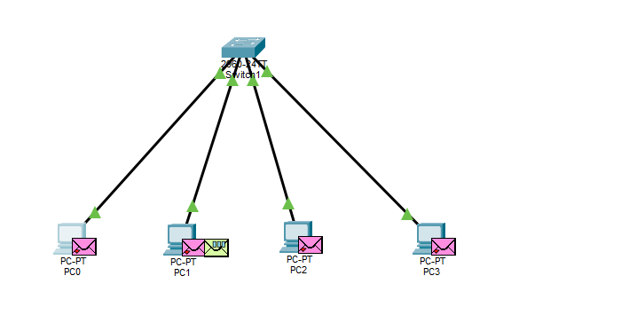

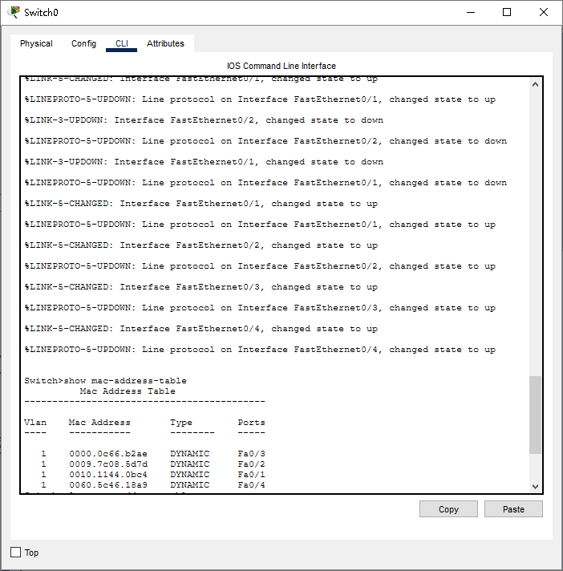

这是端口mac，不是PCmac，试图清空，失败：

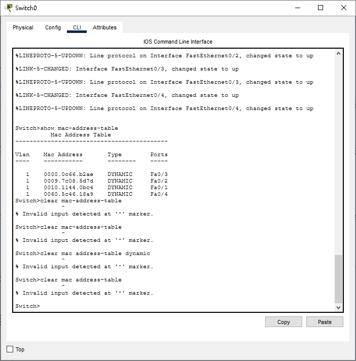

报错是因为**Packet Tracer 模拟器对部分真实 Cisco 命令的支持并不完整**，它简化了某些功能，导致 `clear mac-address-table` 这类命令在模拟环境中无法执行。另外，思科官方文档也指出，带连字符的 `clear mac-address-table` 命令在较新的 IOS 版本中，已被不带连字符的 `clear mac address-table` 取代。

> 后记：不是因为这个，要先enable命令进入特权操作模式就可以直接成功clear mac-address-table了

重启

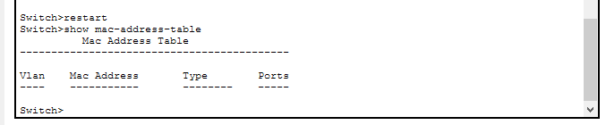

重启命令被我猜到了:-)

从PC0  ping 192.168.1.3  后的交换机端#1PC0->Switch：

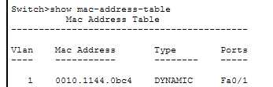

#2Switch->PC2->Switch

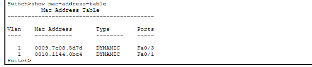

全部ping完：

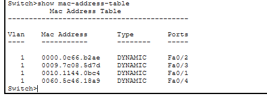

当 **Send** 的时候：

> 一个数据包（信封）从 PC0 发到了交换机 `Fa0/1`。交换机拆开一看，目的 MAC 是 `FFFF.FFFF.FFFF`（广播 MAC 地址），交换机不知道怎么单播，于是把这个包复制了三份，从 `Fa0/2`、`Fa0/3`、`Fa0/4` 全部扔了出去。这就是**泛洪（Flooding）**。

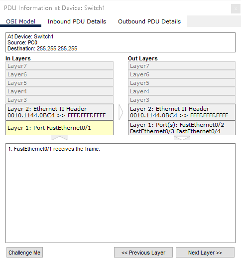

这是PC1~3收到的Switch发送的广播PING：

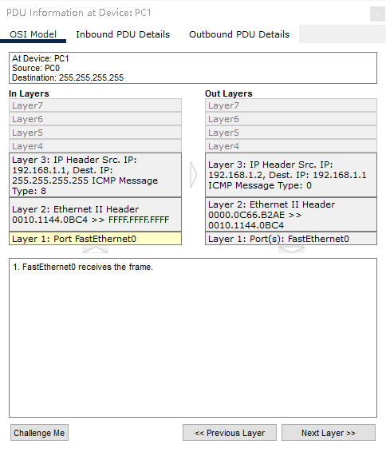

交换机可以分割冲突域（其每个端口对应一个冲突域）（这是交换机比集线器 Hub 强的地方）：

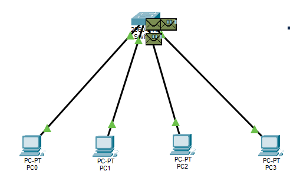

总结：交换机不隔离广播域（所有人都能收到广播包），隔离冲突域（有缓存和等待，不会互相干扰）

总结：先是独立装好了**Cisco Packet Tracer 9.0.1**，搞懂了**MAC地址表的自学习机制**、**广播泛洪**，还弄明白了**冲突域与广播域**的区别。而且还能熟练使用 Packet Tracer 的**模拟模式（Simulation）**和**流量生成器（Traffic Generator）**，乐哉乐哉。

3.3

拓扑图：

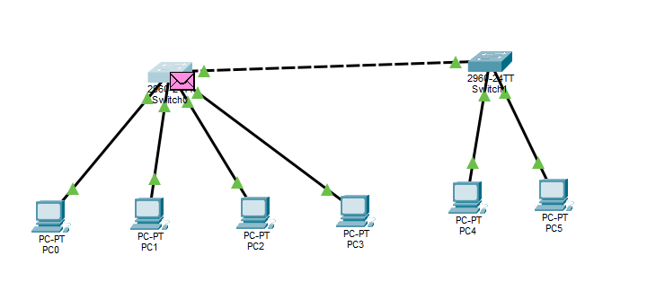

PT里面连接线两端是橙色说明正在监听/学习，一般等30-50s即可

> 检查交换机端口状态：
>
> `show interfaces status` 或 `show spanning-tree`（需要先enable）
>
> **另：使用快速生成树（RSTP）**  
> 如果觉得STP收敛太慢，可以在两台交换机的**全局配置模式**下输入命令 `spanning-tree mode rapid-pvst`，启用快速生成树协议，能大大缩短端口从橙色变绿色的时间。
>
> 另外，如果网络里**只有一条**交换机之间的链路，STP其实不会阻塞它。但如果链路一直保持橙色，还有一种可能是**端口被“err-disabled”**（因错误被禁用）了。这时可以在接口模式下依次输入 `shutdown` 和 `no shutdown` 来尝试恢复端口。

从192.168.1.1PING192.168.1.2已成功：

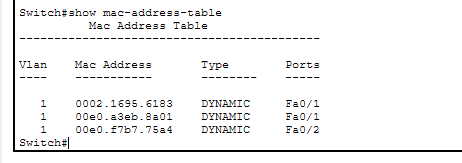

？为什么这里有两个Fa0/1？？（我1端口连的是Switch1）

---

### 原因一：级联端口的学习现象（“大门效应”）

想象一下，交换机的一个端口（比如 `Fa0/1`）就像是一栋大楼的**大门**。

* 如果 `Fa0/1` 连的是一台电脑（PC），那这个大门每次只进出一个人的 MAC 地址。
* 但现在 `Fa0/1` 连的是**另一台交换机**。对面那台交换机连接的所有电脑，它们的数据包都要通过这根线，从 `Fa0/1` 这个“大门”涌进来。
* 交换机是认“源 MAC 地址”的。当对面交换机的 PC4 发数据过来，交换机记下：`PC4的MAC -> Fa0/1`；当 PC5 发数据过来，交换机又记下：`PC5的MAC -> Fa0/1`。
* **结论：连接交换机的级联端口（Uplink Port），通常会学习到多个 MAC 地址。** 这在真实的网络里非常常见，甚至有时候一个端口后面挂着几十台电脑的 MAC。

---

### 原因二：底层协议（STP/CDP）的 MAC 暴露了

仔细看你截图里的两个 MAC 地址：

* `0002.1695.6183`
* `00e0.a3eb.8a01`

你查一下思科的 OUI 就知道，`00e0.a3` 和 `0002.16` 都是**思科设备专用的出厂 MAC 前缀**。
当两台交换机通过 `Fa0/1` 连在一起时，它们会在底层偷偷“聊天”：

* 它们会发送 **STP（生成树协议）** 的 BPDU 报文，防止产生环路。
* 它们会发送 **CDP（思科发现协议）** 报文，互相打招呼。

这两台交换机为了发这些底层报文，会使用设备内部的虚拟 MAC 地址。所以，你的 Switch 在 `Fa0/1` 上抓到的，是对面那台交换机发过来的底层协议 MAC 地址。**因为它连的是交换机，所以抓到的是交换机的 MAC；如果连的是电脑，抓到的就是电脑的 MAC。**

---

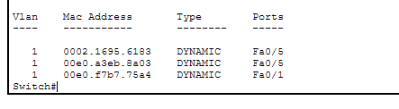

这下对了

泛洪：

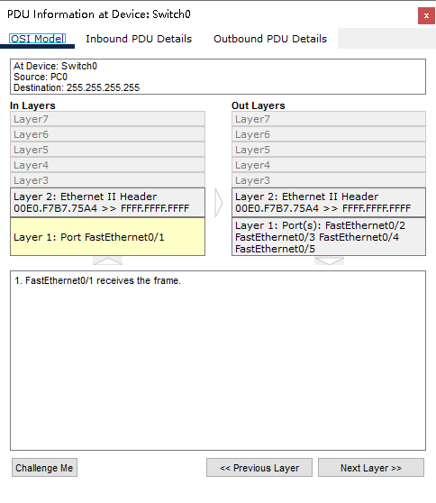

这是到达Switch1后的包：

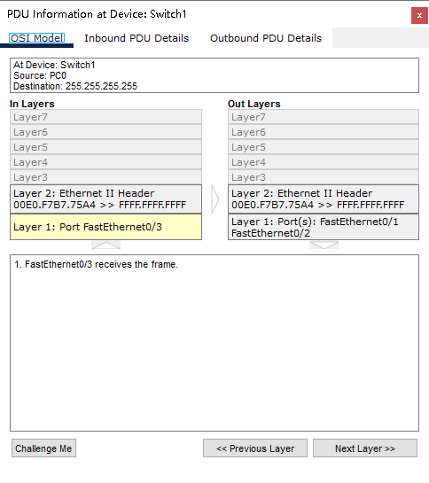

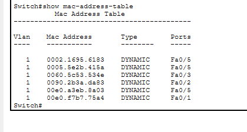

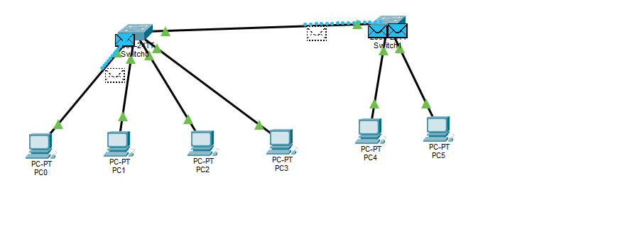

总结：

1. **扩展网络**：通过交换机级联（把两台交换机连起来），可以有效扩展以太网的物理覆盖范围和连接主机数量。

2. **广播域的放大**：交换机是二层设备，**不隔离广播域**。当两台交换机连接后，它们连通的所有主机（PC0-PC5）共同构成了一个更大的、单一的广播域。一个广播包会泛洪到整个网络。

3. **冲突域的隔离**：交换机的级联**依然隔离冲突域**。每台交换机的每个接口都是一个独立的冲突域。当多台主机同时响应广播包时，交换机会利用内部缓存将数据包排队、逐个转发，避免了数据冲突。

另记：

教材P40和P41插图写错了，应该是Fa0/5，端口冲突了
